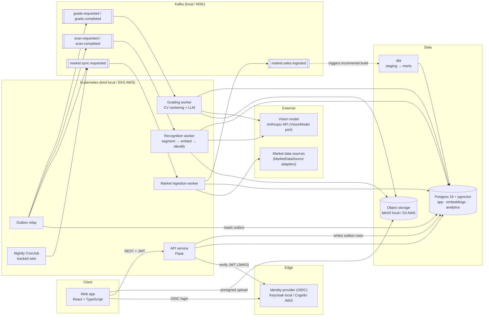
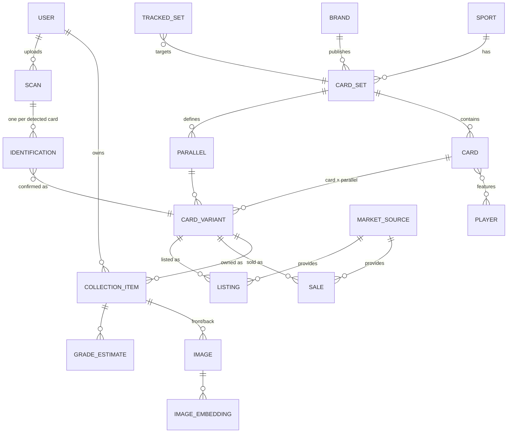

# Card Maven: Implementation Plan

**Status:** Decisions confirmed. Awaiting go-ahead for Phase 0 · **Author:** Planner persona · **Date:** 2026-10-26

Card Maven lets collectors track their sports card collections and value them against live market data. This plan rebuilds the foundation on the target stack in seven gated phases. Each phase ends with a checkpoint, and work does not continue until it is approved.

---

## 1. Decisions captured from clarifying questions

| # | Topic | Decision |
|---|---|---|
| 1 | Market data | A `MarketDataSource` port with pluggable adapters and source-agnostic `sale` and `listing` models. Start free: fixtures, manual/CSV comps, and eBay Browse + Taxonomy. Apply for eBay Marketplace Insights for sold comps. Choose a paid provider only if needed (see §8). |
| 2 | Users | Collectors. Multi-tenant from day one. **Auth is OIDC** (Authorization Code + PKCE) with Keycloak locally and Cognito on AWS. See [auth.md](architecture/auth.md). Every user-owned row carries `owner_id`, and isolation is enforced at the repository layer. |
| 3 | Identification | Vision-model identification, always followed by a user confirmation step. A `ReferenceCatalog` port is stubbed so a licensed checklist can be added later without schema changes. |
| 4 | Grading | v1 combines LLM vision with deterministic OpenCV centering and shows an estimated grade range with a disclaimer. Front and back images are required. |
| 5 | Infrastructure | Everything runs locally in phases 0–5 (Docker Compose, plus kind for Kubernetes manifests). Terraform is written and validated throughout but not applied to AWS until Phase 6. |
| 6 | Warehouse | Postgres 16 with pgvector serves app data and embeddings. dbt runs on the same Postgres in a separate `analytics` schema. |
| 7 | Tracked sets | **Baseball:** Bowman Chrome, Topps Chrome, Topps Series 1/2. **Basketball:** Prizm, Select, Mosaic, Obsidian. **Football:** Prizm, Select, Mosaic, Obsidian. **Hockey:** Upper Deck Series 1 (Young Guns). **Years 2024–2026.** Defined in config, not code (see §9). |
| 8 | Code | GitHub repo `lfoos/card-maven`. Current code is tagged `legacy-v0` and replaced on `master` (see §7). |
| 9 | Personas | Condensed summary per change in chat. Full persona output goes in `docs/changes/`. |
| 10 | Models | Anthropic API first, behind a `VisionModel` port. Every identification and grade estimate stores `model_provider`, `model_type`, and `prompt_version` so results can be compared and reprocessed with another model. |

---

## 2. Architecture



**Key patterns**

- **Modular monolith with workers.** One Flask API organized by bounded context (identity, catalog, collection, market, recognition, grading, analytics), plus stateless Kafka-consumer workers that share the same Python domain package. The services can be split out later without rewriting domain code.
- **Hexagonal ports and adapters** wherever an external dependency is likely to change: `MarketDataSource`, `VisionModel`, `ImageEmbedder`, `ReferenceCatalog`, `ObjectStore`, `EventPublisher`. Each port has a fake adapter for tests and local development.
- **Transactional outbox.** The API never writes to Postgres and Kafka in the same request. It writes an outbox row in the same transaction, and a relay publishes the row. This prevents lost or phantom events.
- **Versioned event contracts.** Events use a CloudEvents-style envelope with a JSON Schema per type in `contracts/events/`. Consumers are idempotent and keyed on event id. Failed messages go to dead-letter topics.
- **Async for slow work.** Scans, grade estimates, and comp fetches return `202 Accepted` with a job resource. The UI polls the job (SSE can come later).
- **Presigned uploads.** Image bytes go from the browser straight to S3/MinIO and never pass through the API.

---

## 3. Core data model

The design separates *what a card is* (catalog) from *what a collector owns* (collection) and from *what the market paid* (market). Sales and collection items both point at the same **card variant**, which is what makes comps, valuation, and trends work.



| Entity | Notes |
|---|---|
| `card_set` | sport, brand, year, name, `catalog_source` (`user_confirmed` now, `reference:<provider>` later) |
| `card` | set, card number, name, team, rookie/1st Bowman flags, players (many-to-many, for dual cards) |
| `parallel` | name, color, print run (`/499`), is_autograph, is_refractor |
| `card_variant` | unique (card, parallel). The join point for sales and holdings. |
| `collection_item` | owner, variant, serial number, condition: `raw` or slabbed (grader, grade, cert #), purchase price/date, notes |
| `sale` | A completed sale: source, `source_listing_id` (unique per source), variant (nullable) + `match_confidence`, raw title, price + currency (minor units), sold_at, sale type, grader/grade, URL |
| `listing` | An active ask, snapshotted per sync: source, `source_listing_id`, variant (nullable) + `match_confidence`, raw title, asking price or current bid, buying option, grader/grade, observed_at, URL. Kept separate from `sale` so an ask is never shown as a sale. |
| `scan` | owner, source image, status |
| `identification` | scan, crop image, bounding box, extracted fields (JSONB), confidence, **`model_provider`, `model_type`, `prompt_version`**, status (`pending`/`confirmed`/`rejected`), confirmed variant |
| `grade_estimate` | item, PSA range (low/high), subgrades, centering measurements (front and back L/R, T/B), rationale, **`model_provider`, `model_type`, `prompt_version`** |
| `image_embedding` | image, embedding model, vector (pgvector, HNSW index) |
| `estimated value` | Not stored on the item. Computed in the dbt mart `mart_variant_value` (recent median for the matching grade) and read by the API. |

Money is stored as integer minor units plus an ISO currency code. All timestamps are UTC.

---

## 4. Repository layout

```
card-maven/
├── apps/web/                      # React + TS (Vite, TanStack Query, React Router)
│   └── src/features/{collection,scan,comps,grading,trends,auth}/
├── services/
│   ├── api/                       # Flask app factory, one blueprint per context
│   └── workers/                   # ingestion, recognition, grading consumers + outbox relay
├── packages/card_maven/           # Shared Python domain (uv workspace)
│   ├── catalog/  collection/  market/  recognition/  grading/  identity/
│   │   └── each: domain.py · ports.py · service.py · repository.py · adapters/
│   └── shared/                    # db session, events, config, errors, logging
├── analytics/dbt/                 # staging → intermediate → marts, tests, seeds (tracked sets)
├── contracts/
│   ├── events/                    # JSON Schemas for Kafka events
│   └── openapi.yaml               # generated from the API, checked in CI
├── infra/
│   ├── terraform/modules/{network,eks,rds,msk,s3,cognito,ecr}/  envs/{dev,prod}/
│   ├── k8s/                       # Helm chart for all services
│   └── compose/docker-compose.yml # Postgres, Kafka (KRaft), MinIO, Keycloak
├── docs/
│   ├── architecture/              # diagram (source of truth), C4 context/container views
│   ├── adr/                       # one ADR per significant decision
│   ├── changes/NNNN-slug/         # persona reports per change (see §6)
│   ├── api/  runbooks/  user-guide/
│   └── IMPLEMENTATION_PLAN.md
├── CHANGELOG.md  Makefile  README.md
```

**Tooling:** uv workspaces, Ruff, mypy (strict), and pytest (with testcontainers for Postgres and Kafka) on the Python side. pnpm, ESLint, Vitest, React Testing Library, MSW, and Playwright on the TypeScript side. Alembic for migrations, Pydantic v2 for API schemas, OpenAPI generated from code. GitHub Actions for CI, pre-commit hooks, Conventional Commits.

**Test bar:** Every module ships with unit tests covering happy paths, edge cases, and failure modes. CI enforces at least 90% line coverage on `packages/` and at least 80% on the web app, plus dbt tests and `terraform validate`, tflint, and checkov.

---

## 5. Phases

Each phase ends at a **checkpoint**: a demo script, a test report, an updated architecture diagram if anything changed, and a release note. I wait for your approval before starting the next phase.

### Phase 0: Foundation
**Enables:** a working skeleton every later phase builds on (no user features yet).
- Archive the legacy app (see §7). Scaffold the monorepo, Makefile, and pre-commit.
- Docker Compose stack: Postgres + pgvector, Kafka (KRaft), MinIO, Keycloak.
- Shared Python package with config, structured logging, error model, DB session, outbox, and event envelope. Health endpoints.
- React shell with routing, auth context, API client, and design tokens.
- Full catalog and collection schema with Alembic migrations, plus seed data (sports, brands, tracked sets).
- CI pipeline. Terraform module skeletons (validated, not applied). Helm chart skeleton. kind smoke deploy.
- Docs: architecture diagram, ADRs 0001–0008 (monolith + workers, hexagonal ports, outbox, OIDC, pgvector, Kafka contracts, model provenance, money/time conventions), contributor guide.

**Exit:** `make up && make test` passes from a clean clone. CI is green. The diagram is merged.

### Phase 1: Identity and collection
**Enables:** Feature 1 (store and display a collection).
- OIDC login with Keycloak locally. The API validates JWTs against JWKS, so it is provider-agnostic and swaps to Cognito in Phase 6. Users are provisioned on first login.
- Collection CRUD API with filtering, sorting, cursor pagination, and owner scoping enforced in repositories.
- Manual add flow with catalog autocomplete. If a card or set doesn't exist yet, it is created as `user_confirmed`.
- Front/back image upload via presigned URLs with type, size, and dimension validation.
- Web: collection grid and table views, card detail page, add/edit forms. Estimated value shows "—" until Phase 2.
- Security baseline: CORS allowlist, security headers/CSP, rate limiting, request size limits, input validation, audit fields.

**Exit:** Two test users each manage their own collections and cannot see each other's data (verified by automated tests).

### Phase 2: Market data pipeline
**Enables:** Feature 3 (Get Comps), Feature 6 (nightly job), and estimated values on collection items.
- `MarketDataSource` port with three adapters (see §8):
  - `FixtureSource`: deterministic, used in dev and tests.
  - `ManualImportSource`: comps the user enters, or uploads as CSV.
  - `EbayBrowseSource`: active asks and supply counts. Built against your sandbox keyset, then pointed at production.
- An eBay Taxonomy sync loads the trading-card fields and allowed values (player, set, parallel, grader, grade) into a lookup table that drives title parsing.
- Every eBay link carries EPN affiliate tracking, which the Marketplace Insights application requires.
- Sale normalization: parse title → grader/grade/parallel/serial, then match to a variant using rules first and vector similarity as a fallback, storing a `match_confidence`.
- Kafka topics plus the ingestion worker (idempotent upserts on `source + source_listing_id`, retries with backoff, dead-letter topic).
- Nightly Kubernetes CronJob that requests syncs for every tracked set. On-demand sync when a user clicks **Get Comps** returns the last 5 matching sales (same grade first, then nearest grade), with current eBay asks shown separately and clearly labeled as asks.
- dbt: `stg_sales`, `stg_listings`, `int_sales_matched`, `mart_variant_value` (from sales, falling back to the median ask when there are no sales, and labeled as such), with freshness and uniqueness tests.
- eBay data is stored and retained according to the eBay API License Agreement. The Security persona reviews its retention terms before this phase ships.

**Exit:** The nightly run populates sales (from fixtures and manual imports) and listings (from eBay Browse). Get Comps returns 5 sales or a clear empty state. Re-running the job creates no duplicates.

### Phase 3: Card recognition
**Enables:** Feature 2 (photo of a group of cards → individually identified cards).
- Upload a group photo → `scan.requested` → recognition worker.
- Segmentation: OpenCV contour detection with perspective correction. If too few cards are found, fall back to vision-model bounding boxes. Each crop is saved as its own image.
- CLIP image embeddings (open_clip, in-container) stored in pgvector. These find matches against previously confirmed cards and supply candidates to the LLM.
- `VisionModel` port with an Anthropic adapter. Structured output (sport, year, brand, set, player, card number, parallel, serial, team) with per-field confidence, provenance stored on every identification.
- Review UI: crops side by side with editable fields, then confirm, edit, or reject. Confirmed cards go into the collection, and confirmations accumulate as labeled data for future accuracy tracking.
- A reprocess command reruns identifications with a different model and compares the results.

**Exit:** A photo of 9 cards on a mat produces 9 crops with prefilled fields. Confirmation adds them to the collection. Each identification records its model provenance.

### Phase 4: Grade estimation
**Enables:** Feature 4 (Estimate Grade plus grade-matched comps).
- Requires both front and back images (enforced in API and UI).
- Deterministic centering from border detection (front and back L/R, T/B ratios) mapped to PSA centering tolerances.
- The vision model assesses corners, edges, and surface. Its output is combined with centering into a PSA range (for example "8–9") with a written rationale and provenance.
- Show comps at the estimated grades next to raw comps, with a persistent disclaimer that this is an estimate, not a PSA grade.

**Exit:** The estimate is reproducible for the same images and model version. Golden-image tests pin the centering math.

### Phase 5: Trends dashboard
**Enables:** Feature 5 (trends across baseball, football, basketball, hockey).
- dbt marts: `mart_sport_daily` (sale volume, active-listing supply, median, index), `mart_set_trends`, `mart_player_momentum` (7/30/90-day price and volume change, with minimum-sample thresholds to filter noise).
- API endpoints over the marts, cached and refreshed after each nightly dbt build.
- Web dashboard: sport tabs, price index and volume charts, rising/falling player lists, and set leaderboards. The dashboard labels its scope as "tracked sets" so it is clear the coverage isn't the whole market.

**Exit:** Dashboard values match dbt test fixtures. Thin-data cases show "insufficient data" instead of misleading numbers.

### Phase 6: AWS deployment and hardening
**Enables:** a real, hosted deployment.
- Apply Terraform: VPC, EKS, RDS Postgres, MSK, S3, Cognito, ECR, Secrets Manager, CloudFront for the web app. Separate dev and prod environments, remote state with locking.
- Helm deploys from CI with OIDC-federated GitHub Actions (no long-lived AWS keys).
- Observability: OpenTelemetry traces, structured logs, CloudWatch dashboards and alarms, Kafka consumer-lag alerts.
- Hardening: least-privilege IAM per service (IRSA), WAF, image scanning, dependency audit, backups and a restore drill, load test, cost alarms.

**Exit:** Production URL live. Runbooks written. Restore drill passed. Projected monthly cost documented.

---

## 6. Per-change persona workflow

Every change (normally one PR) goes through the same loop:

1. **Planner** writes `docs/changes/NNNN-slug/plan.md`: scope, design, data model impact, diagram impact, test plan.
2. **Implementer** writes code and unit tests.
3. **QA** adds edge-case and failure tests, runs the suites, and writes `qa.md`.
4. **Reviewer** writes `review.md` and can send the change back to the Planner or Implementer. Loop-backs are recorded.
5. **Security** writes `security.md`. Blocking findings must be fixed before merge.
6. **Tech Writer** updates README, API docs, user guide, CHANGELOG, and release notes.

In chat, each change gets a summary of 5–10 lines. The full reports live in the repo.

---

## 7. Legacy code

The current repo has a SQLite/vanilla-JS app. Two of its price sources no longer work: the eBay Finding API it calls was decommissioned on 2025-02-04, and it scrapes 130point (a terms-of-service risk). The plan:

- Tag the current `master` as `legacy-v0` so it is preserved and recoverable.
- Replace it on `master` through the Phase 0 PR.
- Carry forward only ideas worth keeping (the scan-card prompt and field list) into the new design. No code is carried over.

---

## 8. Market data source

We start with free sources, apply for the one free source of real sold comps, and add a paid provider only if we need one. Every source plugs into the same `MarketDataSource` port, so changing providers needs no schema change.

| Source | Cost | Provides | Status |
|---|---|---|---|
| **Fixture data** | Free | Deterministic sales and listings | Phase 2, for dev and tests |
| **Manual / CSV import** | Free | Comps collectors enter (including ones found in Terapeak) | Phase 2 |
| **eBay Browse API** | Free (standard developer keys) | Active asks, listing supply, item specifics, image search | Phase 2 for market data. Image search is used in Phase 3. |
| **eBay Taxonomy API** | Free | Trading-card fields and allowed values | Phase 2, used for parsing titles and seeding the catalog |
| **eBay Marketplace Insights API** | Free once approved | Sold items, last 90 days | **Apply now.** Limited release: requires an EPN affiliate account, a Buy API application, a sandbox-reviewable app, and signed contracts. The adapter is built against the sandbox so the app is reviewable. |
| **Paid provider** (SportsCardsPro, Card Ladder, Market Movers, PSA APR) | Paid | Varies | Only if Insights is denied or coverage is thin. SportsCardsPro has no free API tier. Its sister site PriceCharting returns current prices only (no sales history) and licenses data for internal use unless there's a commercial agreement. Confirm licensing for a multi-user app before buying. |
| **Excluded** | — | — | Scraping 130point, eBay pages, or the Terapeak UI (terms of service). Terapeak has no API and stays a manual research tool. |

**Notes**
- **Sold comps vs. asks.** Until Insights is approved, "Get Comps" shows manual and fixture sales, plus current eBay asks labeled clearly as asks.
- **History.** Insights only covers 90 days, so the nightly job keeps its own history, subject to the retention terms in the eBay API License Agreement.

---

## 9. Tracked sets configuration

The nightly job reads a declarative config file, `config/tracked_sets.yaml`. To expand coverage, you add a line and open a PR. No code changes or migrations are needed.

```yaml
defaults:
  years: { from: 2024, to: 2026 }   # widen here to backfill every set
sets:
  - { sport: baseball,   brand: Bowman,      name: Bowman Chrome }
  - { sport: baseball,   brand: Topps,       name: Topps Chrome }
  - { sport: baseball,   brand: Topps,       name: Topps Series 1 }
  - { sport: baseball,   brand: Topps,       name: Topps Series 2 }
  - { sport: basketball, brand: Panini,      name: Prizm }
  - { sport: basketball, brand: Panini,      name: Select }
  - { sport: basketball, brand: Panini,      name: Mosaic }
  - { sport: basketball, brand: Panini,      name: Obsidian }
  - { sport: football,   brand: Panini,      name: Prizm }
  - { sport: football,   brand: Panini,      name: Select }
  - { sport: football,   brand: Panini,      name: Mosaic }
  - { sport: football,   brand: Panini,      name: Obsidian }
  - { sport: hockey,     brand: Upper Deck,  name: Series 1, focus: Young Guns }
  # per-set override example:
  # - { sport: baseball, brand: Bowman, name: Bowman Draft, years: { from: 2020 } }
```

- **Schema validation.** The file is validated (Pydantic) in CI and at startup. A typo fails fast with a clear error.
- **Database sync.** On deploy, a sync job upserts the config into the `tracked_set` table. Removing an entry deactivates it instead of deleting it, so its sales history is kept.
- **Backfill.** Adding a year or a set triggers a one-time historical backfill. A `make backfill SET=... YEARS=...` command is available for manual runs.
