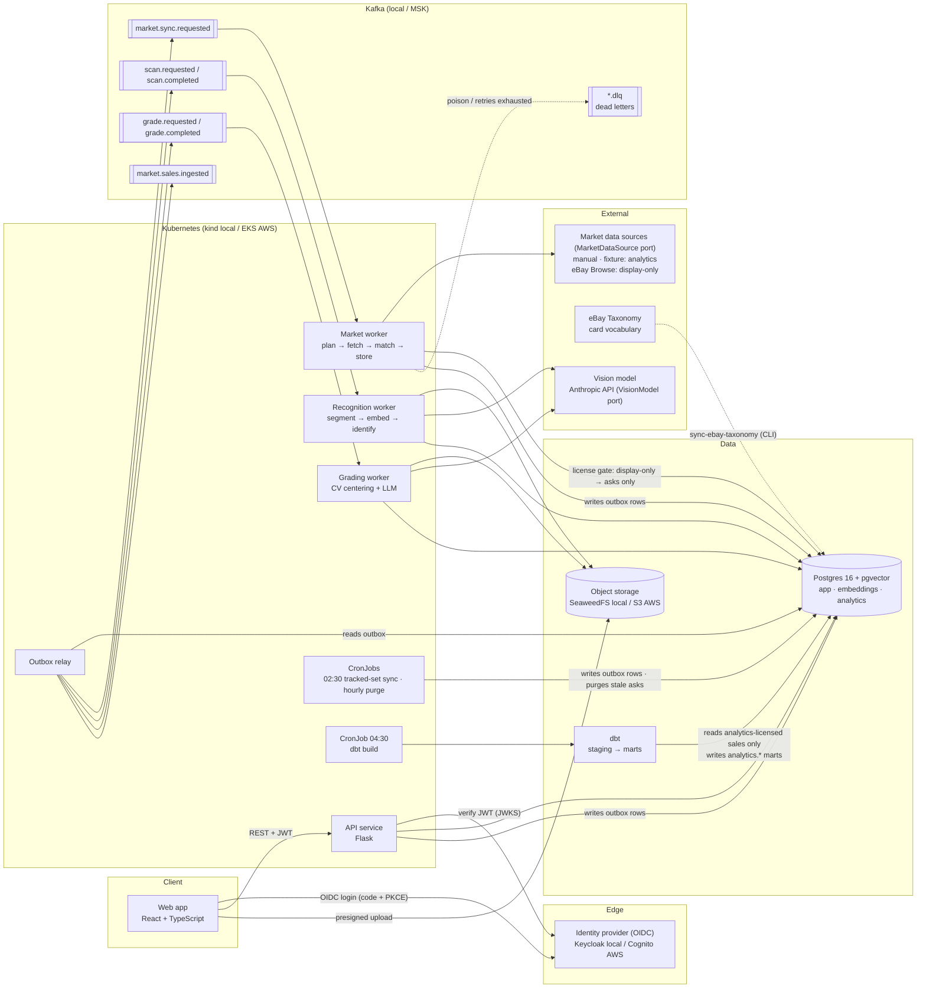
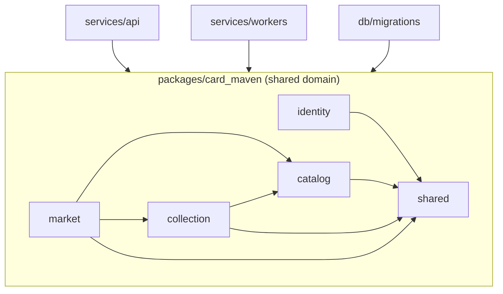
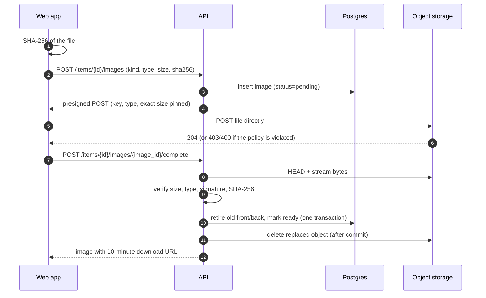
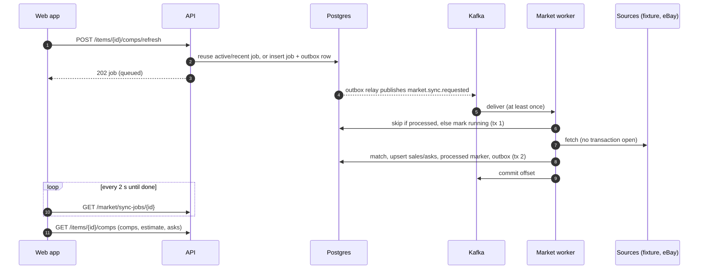

# Card Maven architecture

This is the source of truth for how Card Maven fits together. **Every change checks against this page.** If a change adds, removes, or rewires a component or data flow, the same PR updates the diagram and the status table (see [Keeping this current](#keeping-this-current)).

## System (container view)

## Component status

| Component | Technology | Code | Status |
|---|---|---|---|
| Web app | React 19, TypeScript, Vite, TanStack Query, oidc-client-ts | `apps/web` | Shell and auth (Phase 0). Collection grid/table, add/edit, detail, photo upload (Phase 1). Market panel: comps, estimate, asks, Get comps polling, manual and CSV sales (Phase 2). API types generated from the OpenAPI contract. |
| API service | Flask 3 + flask-openapi3, Flask-Limiter, gunicorn | `services/api` | Health, errors, OIDC (Phase 0). `/me`, catalog autocomplete, collection CRUD, photo uploads, rate limits, OpenAPI contract (Phase 1). Comps, refresh (202 + job), manual sales, sync-job polling, estimates on items (Phase 2). |
| Shared domain | SQLAlchemy 2, Pydantic 2 | `packages/card_maven` | Identity provisioning, catalog resolution, collection service, image verification, owner-scoped repositories, keyset pagination, `ObjectStore` port (Phase 1). `market`: title parser, rule matcher, `MarketDataSource` port with fixture and eBay adapters, sync service, comps and estimates, license gate, retention (Phase 2). |
| Outbox relay | confluent-kafka | `services/workers` | Built (Phase 0) |
| Admin CLI | Click | `services/workers` (`card-maven`) | `seed`, `sync-tracked-sets`, `check-config`, `outbox-relay` (Phase 0). `init-storage` (Phase 1). `market-worker`, `request-market-sync`, `purge-market-data`, `sweep-uploads`, `sync-ebay-taxonomy`, `market-search` (Phase 2). |
| Market worker | confluent-kafka consumer, httpx | `services/workers` | Built (Phase 2): idempotent on event id, 3 retries with backoff, DLQ. Helm Deployment; only component holding eBay keys. |
| CronJobs | Kubernetes CronJob | `infra/helm` | Built (Phase 2): tracked-set sync 02:30, purge + upload sweep hourly, dbt build 04:30 (America/Denver). |
| Recognition worker | OpenCV, CLIP, Anthropic API | `services/workers` | Phase 3 |
| Grading worker | OpenCV, Anthropic API | `services/workers` | Phase 4 |
| dbt project | dbt-core 1.12 + dbt-postgres 1.11 | `analytics/dbt` | Built (Phase 2): staging → `mart_variant_value`, `mart_sales_daily`; unit tests and license-gate test. Trends marts in Phase 5. |
| Postgres + pgvector + pg_trgm | Postgres 16 | `db/migrations` | Schema baseline (Phase 0). Case-insensitive natural keys, trigram search, image lifecycle (Phase 1). Market sources, sales, listings, sync jobs, processed events, taxonomy terms (Phase 2, migration 0003). |
| Kafka | Apache Kafka 3.9 (KRaft) / MSK | `infra/compose/kafka/topics.txt`, `contracts/events` | Local topics + envelope contract (Phase 0). `market.*.v1` payload schemas and `.dlq` topic (Phase 2). |
| Object storage | SeaweedFS 4.51 (S3 API) / S3 | `shared/storage`, `infra/terraform/modules/media_bucket` | Card photos via presigned POST, verified server-side (Phase 1) |
| Identity provider | Keycloak 26 / Cognito | `infra/compose/keycloak` | Local realm (Phase 0). Cognito in Phase 6. |
| Infrastructure | Terraform, Helm | `infra/terraform`, `infra/helm` | Network, media bucket, ECR modules, chart (Phase 0). EKS, RDS, MSK, Cognito in Phase 6. |

## Code layout (component view)

- **Bounded contexts** (`identity`, `catalog`, `collection`, `market`, and later `recognition` and `grading`) each own their models and services. Contexts reference each other only through the `card_variant` and `app_user` ids.
- **`shared` holds infrastructure only.** That covers config, logging, errors, money, clock, the database base, events, and the outbox. It never imports a context.
- **Ports and adapters.** External dependencies sit behind ports (`EventPublisher`, `ObjectStore`, and `MarketDataSource` today; `VisionModel`, `ImageEmbedder`, and `ReferenceCatalog` as they arrive). Each port has a fake for tests.
- **Owner scoping.** Every query over user-owned rows is built by `OwnedRepository._scoped()`, so isolation between collectors is structural, not a per-endpoint check.
- **Contract-first API.** Routes declare Pydantic request and response models. The OpenAPI spec is generated from them into `contracts/openapi.json`, and the web app's TypeScript types are generated from that file. CI fails if either drifts.

## Photo upload flow

## Market sync flow (Get comps)

**License gate** ([ADR-0009](../adr/0009-market-data-licensing.md)). Each `market_source` row is `analytics` or `display_only`. Display-only data (eBay) is stored only as fresh, matched listings: it's shown as asks, purged after 6 hours, and excluded from comps, estimates, events and dbt.

## Data model

See [plan §3](../IMPLEMENTATION_PLAN.md#3-core-data-model) for the full entity diagram. The rule that holds everything together is that **collection items and market data both point at a `card_variant`** (card × parallel). Every set has a "Base" parallel, so a variant always exists.

## Cross-cutting decisions

- **Auth:** [auth.md](auth.md).
- **ADRs:** [../adr](../adr/README.md). Each records one decision and its trade-offs.

## Keeping this current

A PR must update this page when it does any of the following:

- adds, removes, or renames a deployable component, datastore, topic, or external dependency
- changes how two components talk (sync vs. async, a new topic, a new port)
- changes where data lives or who owns it

The Planner states the "diagram impact" in each change's `plan.md`, and the Reviewer checks it. Changes that don't fit the current picture also get an ADR.
