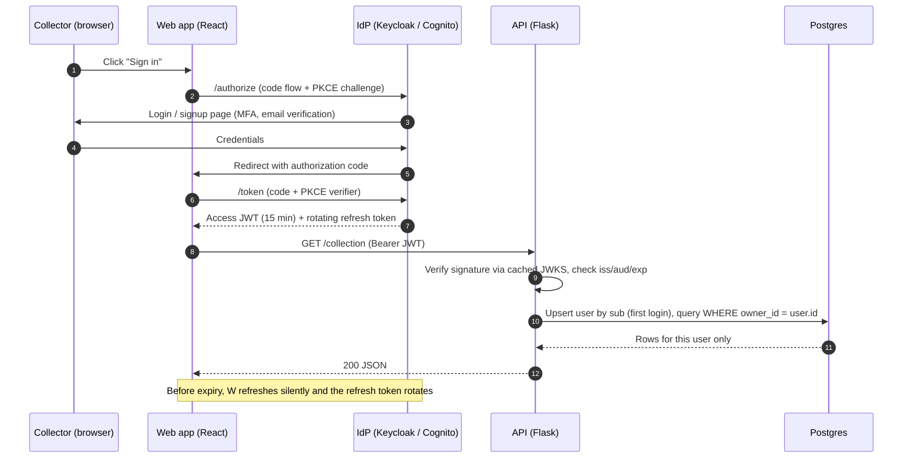

# Authentication & Authorization

**Decision:** OpenID Connect (OIDC) with an external identity provider (IdP). Card Maven never stores passwords.
**IdP:** Keycloak locally (Docker Compose) and Amazon Cognito on AWS (Phase 6). Switching is a config change.

## How it works

1. **Login.** The web app sends the user to the IdP using the **Authorization Code flow with PKCE** (the OAuth 2.1 standard for browser apps). The IdP handles signup, email verification, password policy, password reset, MFA, and lockout.
2. **Tokens.** The IdP redirects back with a one-time code. The web app exchanges the code (plus its PKCE verifier) for:
   - an **access token**: a short-lived (15 min) signed JWT,
   - a **refresh token**: longer-lived and rotated on every use.
3. **Storage.** Tokens are kept in memory only. They are never written to localStorage, which keeps them out of reach of XSS. On page reload, the app silently re-authenticates with the IdP session.
4. **API calls.** Every request carries `Authorization: Bearer <access token>`. The API checks:
   - the signature against the IdP's **JWKS** (public keys, cached and rotated automatically),
   - `iss`, `aud`, `exp`, and `nbf`.
5. **Identity mapping.** The token's `sub` claim maps to a `users` row, which is created on first login (just-in-time provisioning). That row's id becomes the `owner_id` on everything the user creates.
6. **Authorization.** Every repository query is scoped by `owner_id`. This is enforced in one shared base repository, not in individual endpoints. Catalog and market data are global and read-only to users. Roles (`collector`, `admin`) come from a token claim.

## Why this approach

- **No credential handling in our code.** Password storage, MFA, account recovery, and breach-sensitive logic stay with a hardened IdP.
- **Provider-agnostic.** The API only checks standard JWT claims against a JWKS URL. Moving from Keycloak to Cognito (or Auth0 or Okta) changes three config values: issuer, audience, and JWKS URL.
- **Stateless API.** Any pod can validate any request, so the API scales horizontally without shared sessions.

## Baseline protections (Phase 1)

| Protection | Details |
|---|---|
| Transport and CORS | TLS everywhere outside local development. Strict CORS allowlist. |
| Rate limiting | Per user and per IP on the API. The IdP adds its own lockout on login. |
| Security headers | CSP, HSTS, `X-Content-Type-Options`, `Referrer-Policy`. |
| Input validation | Pydantic validation on every request. Request size limits. |
| Uploads | Presigned uploads restricted by content type, size, and owner-prefixed object key. |
| Audit fields | `created_by`, `created_at`, `updated_at` on owned rows. Auth events logged without token contents. |
| Isolation tests | Automated tests confirm one user can't read or modify another user's data. |
